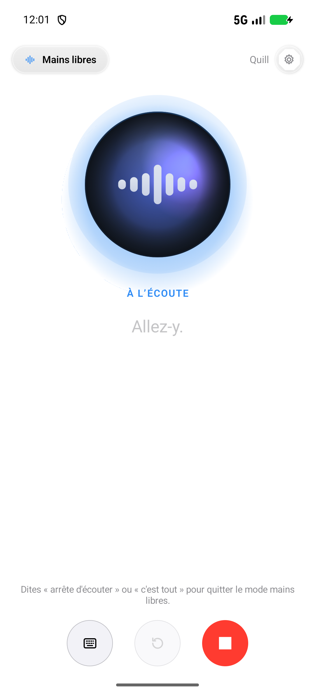
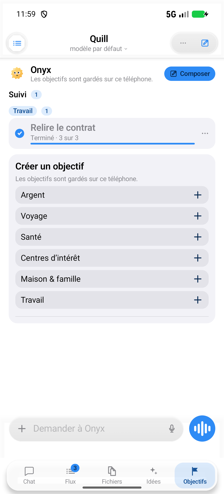
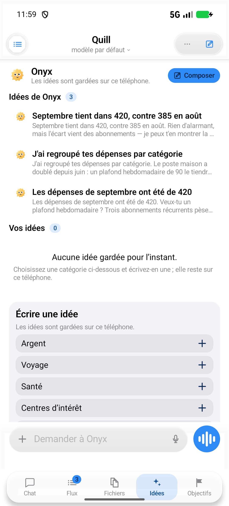

<div align="center">

# Hermes Onyx

**The Android client for the Hermes agent you run yourself.**
Bots with faces, rooms where they answer each other, hands-free voice — and your own computer in your pocket.

[](https://kotlinlang.org)
[-3DDC84?logo=android&logoColor=white)](#requirements)
[](#tests)
[](https://github.com/JemaOS/hermes-onyx/actions/workflows/build.yml)
[](https://github.com/JemaOS/hermes-onyx/releases/latest)
[](LICENSE)

<p>
  
  
  
  
  
</p>

</div>

---

Onyx is not a chatbot in somebody else's cloud. There is no account to create, no key baked into the
APK, and no telemetry. You point it at the Hermes Dashboard you already run, and it becomes the remote
control for your own agents: a chat that streams, a room where several bots answer each other, a voice
you can talk to with the phone in your pocket, and a live view of the machine they work on.

If you have ever wanted the *whole* agent — tools, sub-agents, cron, files, terminal — reachable from a
phone without handing your prompts to a third party, this is that app.

## Features

**A conversation, five tabs deep**

- **Five tabs in every conversation** — **Chat**, **Feed**, **Files**, **Ideas** and **Goals** sit in a
  bar at the bottom of the thread. The Feed collects the bot's answers as dated cards you can rate,
  discuss or turn into a goal; Files holds what the bot delivered and what you attached; Ideas and
  Goals stay on the phone, grouped by category.
- **Streaming answers** over SSE: reasoning folded away, tool calls, approval cards, follow-up questions
  you send with one tap, "jump to latest", and an error banner that tells you what the server said.
- **Rich Markdown** — tables, code with copy, maths with KaTeX, diagrams with mermaid, link previews, image
  and video viewers, text selection across messages.

**Bots and rooms**

- **Bots, side by side** — every profile on your server with its own face, prompt, toolset, schedules and
  voice. Create one, edit it, hide it, reorder them.
- **Rooms** — pick the members, then let them talk to each other while you watch, answer, approve or
  interrupt.

**Code**

- **A Code tab** — the code sessions you have started, filtered **All / In progress / Yours / Ready**,
  each row carrying its branch and status. The repository, the worktree and the branch are read back
  from the server, never guessed; a session's status is the state of the real turn that started it, and
  a failure shows the transport error as it came.

**Voice**

- **Hands-free with real turn-taking** — barge-in, back-channel words, spoken stop phrases, and a large
  speaking face that follows the level of the voice.
- **Rooms that take their turn** — in a voice room, one question goes out and the bots answer **one
  after another**, each read in its own voice; when nobody answers, the app says so instead of leaving
  you in front of a silent face.
- **A voice per bot** — each one speaks with its own installed voice, in a room as well as solo.
- **Two languages at once** — speech and reply language are chosen separately, so you can talk French and
  be answered in English.

**Your computer**

- **Computer** — see your machine's screen and drive it by touch, with an approval gate before any command
  runs. When the picture stops updating, the app reconnects by itself and picks the session back up.
- **Live numbers** — round-trip, jitter, frames per second, dropped and missed frames, bandwidth — so you
  can tell a slow link from a stopped one.
- **Adaptive quality** — the stream steps down through a quality ladder, with a floor below which the
  image would stop being readable.

**The rest of your server**

- **Kanban, Cron, Files, Terminal, Skills, Models, Tools, Servers, Logs** — the board, the schedules, the
  server's files, an SSH terminal, all from the phone.
- **One key** — the all-in-one link puts the Dashboard and the chat at the **same address** behind a
  **single key**: no user name, no password to retype, and the bots, the rooms and the live stream arrive
  the way chat does.
- **Sub-agents** — when an agent fans its work out, the children appear as a task list with their own
  transcript and a stop button.
- **Small courtesies** — a widget, notifications, a lock screen, light and dark themes with several
  palettes, and an interface in **English or French** — or **System**, which follows the phone and is
  what you get until you choose otherwise.

## Screenshots

| Chat | Feed | Ideas | Code sessions |
|:---:|:---:|:---:|:---:|
|  |  |  |  |

The bot roster in the first picture is a real one: the app lists the profiles your server exposes, so a
profile called `QA-tester` appears under that name.

Every screenshot in this README was taken on an emulator, with the **1.0.0+423** build, against a test
server holding demo data — no real machine, no real conversation, no token.

## Install

The signed APKs are on the [latest release](https://github.com/JemaOS/hermes-onyx/releases/latest) page.
Three applications, one signing key, built from one code base:

| File | Runs on | What it is |
|---|---|---|
| `Hermes-Onyx-1.0.0+423-telephone.apk` | Phone, Android 8.0+ | The app: chat and its five tabs, bots, rooms, voice, code, computer, servers, kanban, cron, files, terminal, widget. |
| `Hermes-Onyx-1.0.0+423-auto.apk` | Android Auto | The car: an "Ask" screen that streams the answer into a message card and reads it aloud. |
| `Hermes-Onyx-1.0.0+423-wear.apk` | Wear OS 3+ (API 30) | The watch: a large microphone button, a live oscillogram, five states, and an "Ask Onyx" tile. |

The three names above are the exact asset names on the release. Each release also carries a
`SHA256SUMS` file with the SHA-256 of the three APKs — check your download against it:

```bash
curl -LO https://github.com/JemaOS/hermes-onyx/releases/latest/download/SHA256SUMS
sha256sum -c SHA256SUMS
```

1. Download the APK for your device, open it, allow the install (the build is signed).
2. On first launch, scan the setup code from your server or type its address.
3. Pick a model, and talk.

The app talks to one host only: the one you typed. The API key sits in the Android Keystore, and
conversations stay in DataStore on the device.

## Requirements

- **Android 8.0 (API 26)** or newer — **Wear OS 3 (API 30)** for the watch.
- **A Hermes server you can reach**: a Dashboard (sessions, cron, kanban, files, gateway) and a
  conversation endpoint. The app asks for both; a single address can serve both if you proxy them together.

## Architecture

Four Gradle modules, one rule: nothing that is not a screen lives in a screen.

```
hermes-onyx/
├── app/     the phone app — screens, navigation, notifications, widget
├── core/    models, networking (OkHttp + JSON-RPC), design system, localization
├── wear/    a Wear OS companion — ask screen and tile
├── auto/    an Android Auto companion — ask screen
├── design/  source SVGs for the icons and the speaking orbs
├── scripts/ release archiving, orb rendering, gateway proxy
├── tools/   the computer bridge, icon tooling
└── docs/    the screenshots used by this README
```

- `core` holds no screen beyond Compose primitives, and it is unit-testable on a plain JVM.
- Every user-visible string goes through the localization catalogs in
  `core/src/main/java/com/onyx/app/localization/` — no hard-coded text in a screen.
- The wire protocol is the server's JSON-RPC over the Dashboard, plus an OpenAI-compatible
  `/v1/chat/completions` for the conversation stream.

## Build

You need **JDK 21** and the **Android SDK** (platform 36, build-tools 36).

```bash
./gradlew :app:assembleDebug        # a debug APK
./gradlew :app:assembleRelease      # a release APK
./gradlew :wear:assembleRelease :auto:assembleRelease
```

Release signing is deliberately out of the tree: point `ONYX_RELEASE_KEYSTORE` at a properties file
holding `storeFile`, `storePassword`, `keyAlias` and `keyPassword`. Without it the release build stays
unsigned instead of failing. `versionCode` is the commit count plus `onyx.versionBaseline`, so it only
ever goes up and an APK installs over the previous one.

## Tests

```bash
./gradlew :core:testDebugUnitTest :app:testDebugUnitTest
```

**1683 tests, 0 failures** — 791 in `:core`, 892 in `:app`, across 260 test classes. Plain JUnit 4, no
emulator: networking runs against an in-memory MockWebServer, so the recipe works offline and takes about
two minutes. CI runs the same command on every push.

The Wear OS and Android Auto modules have no unit tests of their own; they are verified at APK level —
build, signature, manifest, components.

## Roadmap

- [ ] A tablet and foldable layout with two panes side by side.
- [ ] Publish the Wear and Auto companions to Play, not only as APKs.
- [ ] A per-room voice mixer, so three bots do not all speak at the same level.
- [ ] Translations beyond English and French.
- [ ] Emulator-driven end-to-end tests on CI, not only the JVM suite.

## Contributing

Issues and pull requests are welcome. Four rules keep the tree healthy:

1. The test recipe stays green: `./gradlew :core:testDebugUnitTest :app:testDebugUnitTest`.
2. One change per pull request, with the reason in the description.
3. New user-visible text goes through the localization catalogs.
4. No secret, key, token or personal address lands in the tree.

## License

[MIT](LICENSE) © JemaOS. Use it, fork it, ship it — keep the copyright notice.

Bundled third-party components keep their own licenses; the full texts ship in
`core/src/main/assets/rich/LICENSES/` and are listed below.

## Acknowledgements

Onyx stands on the shoulders of others. Each license below was checked at its source — the Gradle module
metadata for the libraries, the shipped license file for the embedded assets:

- **[AndroidX](https://developer.android.com/jetpack/androidx)** and **[Jetpack Compose](https://developer.android.com/jetpack/compose)** — Apache-2.0, © The Android Open Source Project.
- **[Kotlin](https://kotlinlang.org/)**, **[kotlinx.coroutines](https://github.com/Kotlin/kotlinx.coroutines)**, **[kotlinx.serialization](https://github.com/Kotlin/kotlinx.serialization)** — Apache-2.0, © JetBrains s.r.o.
- **[OkHttp](https://square.github.io/okhttp/)** — Apache-2.0, © Square, Inc.
- **[Markwon](https://github.com/noties/Markwon)** — Apache-2.0, © Dimitry Ivanov.
- **[sshj](https://github.com/hierynomus/sshj)** — Apache-2.0, © Jeroen van Erp and contributors.
- **[EdDSA-Java](https://github.com/str4d/ed25519-java)** — CC0 1.0 Universal, © str4d.
- **[ZXing Android Embedded](https://github.com/journeyapps/zxing-android-embedded)** — Apache-2.0, © the ZXing authors and JourneyApps.
- **[KaTeX](https://katex.org/)** — MIT, © 2013-2020 Khan Academy and other contributors; its fonts under the SIL OFL 1.1.
- **[mermaid](https://mermaid.js.org/)** — MIT, © 2014-2022 Knut Sveidqvist.
- **[Inter](https://rsms.me/inter/)** — SIL OFL 1.1, © The Inter Project Authors.
- **[Source Code Pro](https://github.com/adobe-fonts/source-code-pro)** — SIL OFL 1.1, © Adobe (reserved font name "Source").

---

<div align="center">
<sub>No account. No telemetry. Your agent, your server, your phone.</sub>
</div>
