<div align="center">

# Hermes Onyx

**The Android client for the Hermes agent you run yourself.**
Bots with faces, rooms where they answer each other, hands-free voice — and your own computer in your pocket.

[](https://kotlinlang.org)
[-3DDC84?logo=android&logoColor=white)](#requirements)
[](#tests)
[](https://github.com/JemaOS/hermes-onyx/actions/workflows/build.yml)
[](https://github.com/JemaOS/hermes-onyx/releases/latest)
[](LICENSE)

<p>
  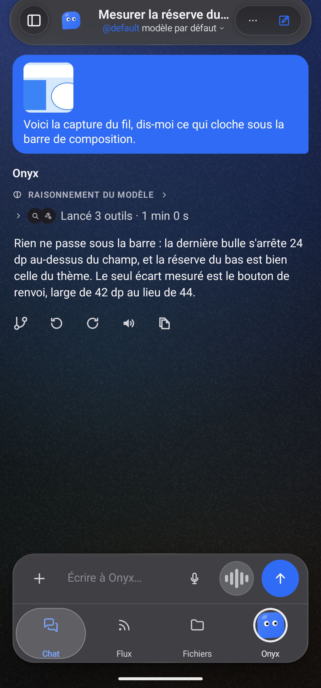
  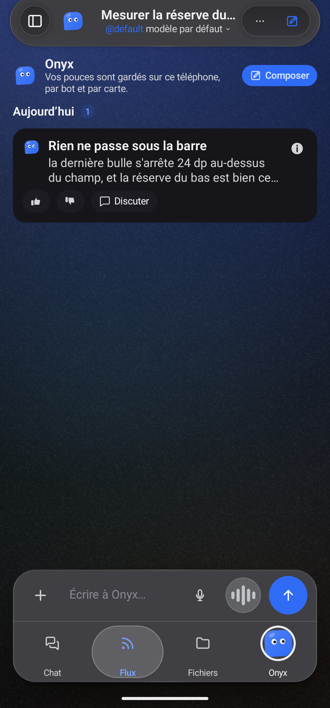
  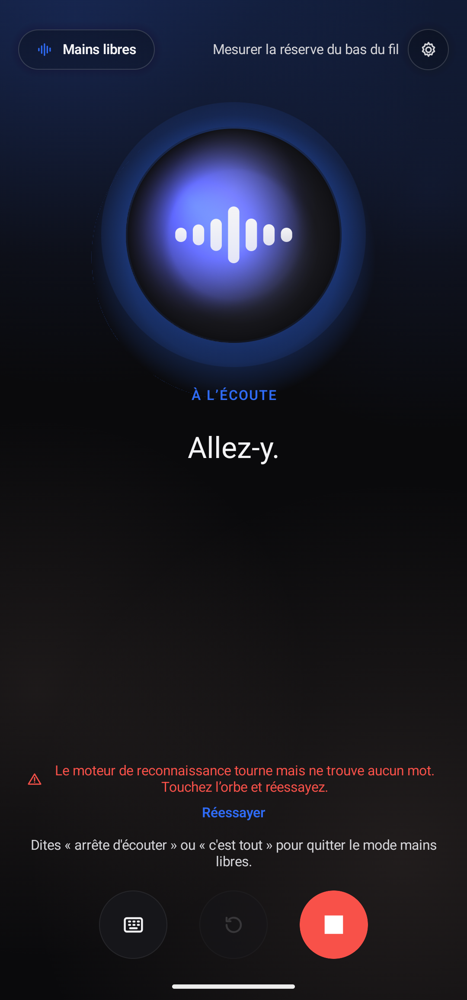
  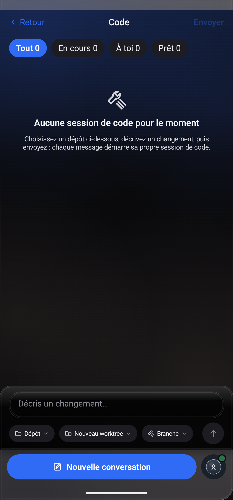
</p>

</div>

---

Onyx is not a chatbot in somebody else's cloud. There is no account to create, no key baked into the
APK, and no telemetry. You point it at the Hermes Dashboard you already run, and it becomes the remote
control for your own agents: a chat that streams, a room where several bots answer each other, a voice
you can talk to with the phone in your pocket, and a live view of the machine they work on.

If you have ever wanted the *whole* agent — tools, sub-agents, cron, files, terminal — reachable from a
phone without handing your prompts to a third party, this is that app.

## Features

**Where a conversation starts**

- **A sidebar with two lives** — one pane carries your **conversations**, and the same pane carries your
  **bots**: a two-position switch (**Chats** / **Bots**) moves between them, so the bots are never mixed
  into the conversation list, and the *Bots* label carries how many of them are waiting for you. The
  pane shows the gateway's name, its address and a reachability light, a search field, the tiles to the
  app's screens (**Scheduled, Overviews, Capabilities, Plugins, Configuration, Archives**, then
  **Skills, Files, Models, Kanban, Code**), your **projects**
  with their counts, the filters — **All**, **Running**, **Waiting for you** — with their counts, and the
  conversation rows with their age. On a wide screen it stands **beside** the thread; on a phone it
  unfolds over it and folds back with one tap.
- **A composer that says what it will do** — the **model chip** sits in the composer itself and carries
  the **reflection level** the server allows (`model | level`): both read from the server, never a value
  the app invented.
- **A model selector made for a long list** — search across models and providers, a **Favourites**
  section of its own above the recents, and the choice remembered **per bot**: a conversation opens on
  the model its bot was given. A model whose source states no price shows none.
- **The attachment sheet** — the "+" opens a sheet anchored at the bottom, with a handle, a title and its
  limits written out — **up to 10 attachments · 25 MB in all · 25 MB per file · 128 KB for a text
  file** — then library, camera, files, paste. A file over those limits is **refused as it is added**,
  with its own size beside the limit, instead of being read, encoded and sent.
- **Conversation actions, in a sheet** — the "…" opens a bottom sheet instead of a floating card:
  *find in conversation*, *rename*, *export as Markdown*, *take a note*, *start fresh*, and the three
  panels — **Usage & cost**, **Background processes**, **Restore points** — plus *copy session id*.

**A conversation, five tabs deep**

- **Five tabs in every conversation** — **Chat**, **Feed**, **Files**, **Ideas** and **Goals** sit in a
  bar at the bottom of the thread. The Feed collects the bot's answers as dated cards you can rate,
  discuss or turn into a goal; Files holds what the bot delivered and what you attached; Ideas and
  Goals stay on the phone, grouped by category.
- **Streaming answers** over SSE: reasoning folded away, tool calls, approval cards, follow-up questions
  you send with one tap, "jump to latest", and an error banner that tells you what the server said.
- **A reply block of its own** — the reasoning is **framed** above the answer, and **four aligned
  actions** sit under it: **restore, regenerate, read, copy**. *Restore to this message* asks first and
  states the consequence; done, it says where it restored and how much was removed.
- **Rich Markdown** — tables, code with copy, maths with KaTeX, diagrams with mermaid, link previews, image
  and video viewers, text selection across messages.
- **The Files tab, exhaustively** — every file the bot delivered and every one you attached, in a single
  list: **type filters that carry their counts** (Images 3, Videos 1, Audio 1, Documents 3, Archives 1),
  **five sorts** (recent, oldest, name, size, type), and a state per row — **to download**,
  **downloading**, **available**. Each family opens where it belongs: **audio** in the app's own player,
  **documents** as text or a paged PDF, **archives** as the list of their entries, photos and videos in
  the built-in viewers; a file the app cannot show is handed to the system, and the row says why rather
  than leave the tap dead.
- **Share to Onyx** — send a picture from another app straight into the conversation: the image is filed
  on the server and **reaches the model** with your next message, not merely shown on screen.

**Bots and rooms**

- **Bots, side by side** — every profile on your server with its own face, prompt, toolset, schedules and
  voice. Create one, edit it, hide it, reorder them.
- **Rooms** — pick the members, then let them talk to each other while you watch, answer, approve or
  interrupt.

**Code**

- **A Code tab** — the code sessions you have started, filtered **All / In progress / Yours / Ready**,
  each row carrying its branch and status. The repository, the worktree and the branch are read back
  from the server, never guessed; a session's status is the state of the real turn that started it, and
  a failure shows the transport error as it came.
- **Act on a session** — long-press a card for its four actions: **rename** it, **edit** its repository,
  worktree, branch and prompt, **run again** as a fresh session, or **delete** the card — that one
  destructive, set apart from the rest, behind a confirmation that states the consequence.

**Voice**

- **Hands-free with real turn-taking** — barge-in, back-channel words, spoken stop phrases, and a large
  speaking face that follows the level of the voice.
- **Rooms that take their turn** — in a voice room, one question goes out and the bots answer **one
  after another**, each read in its own voice; when nobody answers, the app says so instead of leaving
  you in front of a silent face.
- **A voice per bot** — each one speaks with its own installed voice, in a room as well as solo.
- **Two languages at once** — speech and reply language are chosen separately, so you can talk French and
  be answered in English.

**Your computer**

- **Computer** — see your machine's screen and drive it by touch, with an approval gate before any command
  runs. When the picture stops updating, the app reconnects by itself and picks the session back up.
- **Live numbers** — round-trip, jitter, frames per second, dropped and missed frames, bandwidth — so you
  can tell a slow link from a stopped one.
- **Adaptive quality** — the stream steps down through a quality ladder, with a floor below which the
  image would stop being readable.

**The rest of your server**

- **Kanban, Cron, Files, Terminal, Skills, Models, Tools, Servers, Logs** — the board, the schedules, the
  server's files, an SSH terminal, all from the phone.
- **Capabilities** — a profile's **skills**, **toolsets** and **MCP servers** on one screen, each on its
  own switch. A switch writes the profile's configuration and applies to the **next** conversation, says
  so, and comes back if the server refuses the change.
- **Insights** — what a profile consumed over 7, 30 or 90 days: the cost (estimated, or the provider's
  real figure when it gives one), the sessions, the tokens in and out, the share served from the cache,
  and the tokens **day by day**. Every figure comes from the server's usage report; when the route is
  missing or the answer unreadable, the screen says so and shows no card at all.
- **One key** — the all-in-one link puts the Dashboard and the chat at the **same address** behind a
  **single key**: no user name, no password to retype, and the bots, the rooms and the live stream arrive
  the way chat does.
- **Sub-agents** — when an agent fans its work out, the children appear as a task list with their own
  transcript and a stop button.
- **Small courtesies** — a widget, notifications, a lock screen, light and dark themes with several
  palettes, and an interface in **English or French** — or **System**, which follows the phone and is
  what you get until you choose otherwise. The **menus translate too**, end to end: the long-press
  menus, the row menus and the sheet titles read French as well, not only the screens.
- **Liquid glass** — the composer and the bars are a **real blur** over what is behind them, not a flat
  veil; **a face that lives** — a bot's face blinks, looks around and breathes, and its mood follows
  what it is doing while it thinks or speaks.
- **Room to breathe** — the bottom bars and the headers keep their distance from the system gesture
  area, so the tab strip no longer sits against the swipe zone; and the menu icons follow one house
  stroke, so a menu reads the same everywhere in the app.

**What your server decides**

Three of these read routes a server may not answer, and the app says so rather than dress up an empty
screen. **Restore points** come from `rollback.list`, which returns `enabled: false` and no checkpoint on
a server that keeps them switched off; **Background processes** come from `process.list`, empty there
too. **Usage & cost** reads `session.usage`, which carries **no price field**: the panel shows `—` and
the sentence the server gave it, never a made-up figure.

## Ce que 1.0.0+972 apporte

Cette vague est la **fusion de onze lots**. Chaque point ci-dessous cite le commit, le fichier ou la
mesure qui le porte — rien n'est annoncé ici qui ne puisse être montré. Le détail complet est dans
[`releases/NOTES-1.0.0+972.md`](releases/NOTES-1.0.0+972.md).

- **La palette et les surfaces sont lues dans la source** — six palettes de la référence comparées
  champ par champ : **54 valeurs, 54 identiques, 0 écart** ; le verrou de palette relève **412 sources
  lues, 0 couleur hors palette** (`3cd0f588`).
- **Le thème sombre est mesuré, barreau par barreau** — le compositeur passe de **1,058:1** à
  **1,314:1** sur sa page, la capsule d'onglet actif tient **1,201:1** contre sa barre, son encre
  d'accent **5,165:1** ; une seule famille de formes (coins **22 → 26 dp**) et d'ombres (`a8c50987`,
  `UI-UNIFORMITY-SOMBRE.md`).
- **Le verre liquide passe en Haze 2.0.1, avec réfraction et soudure** — modules `haze`, `haze-blur`,
  `haze-glass` ; la réfraction déplace le contenu échantillonné selon le profil d'arête
  (`RefractionProfile.Edge`), et `GlassRefractionAvailable = true` est une **mesure** ; la soudure des
  formes sort des traces (`13033ee5`, `4f414fde`).
- **Une barre du bas flottante** (`52d0a4cf`) et **des boutons ronds sans facettes** — les octogones
  deviennent des cercles (`794472c7`).
- **Le suivi du défilement** du fil (`af6f86e6`) et **le glissement des conversations à deux sens**
  (`da32ba08`).
- **L'appel entrant et les heures de tranquillité** — le téléphone sonne comme un appel, plein écran,
  et les heures de tranquillité coupent la sonnerie (`4cc98475` ; `CallRinger.kt`, `QuietHours`,
  `CallsScreen.kt`).
- **TIFF, HEIC et AVIF** en plus des formats courants (`363a1cb0`, `02f7a517`) ; **le widget HTML
  réparé** — repli immédiat, pont et mesure de la page de nouveau en scripts (`b7afc4dd`, `b523abef`).
- **L'organisation du fil et les sous-agents** — liste de tâches, transcription, durée et arrêt
  (`5ddc604e`, `170ed926`).
- **Le doublon « Compétences » retiré** — la tuile du volet et la ligne des Réglages quittent
  l'interface, le groupe « Onyx » passe à quatre tuiles, tout est **dans** « Capacités » (`64d8e756`).
- **Les retours corrigés** — la page quittée n'est plus perdue au sortir du volet, et un banc mesure les
  trois chemins (`f48b2fcd`, `bdb8d2e0`, `RETOUR-AUDIT.md`).

**3596 tests, 0 échec.** Les compagnons Android Auto et Wear OS ne changent pas sauf s'ils sont
fournis avec cette release ; sinon ils restent sur **`1.0.0+972`**.

## What 1.0.0+547 brought

A design-QA pass over `1.0.0+546`: **eleven major defects**, every one of them visible on
screen, measured and corrected.

- **The top bar measured its title in English and drew it in French.** A French title was
  truncated against an English measurement, so the bar read « Nouvelle convers… » at 1,3×.
  The title is now translated *before* it is measured (`resolvedTitle`).
- **The Feed printed the thumbs sentence twice.** The note asking you to rate a card
  appeared twice in the same feed; the duplicate footer item is gone.
- **The Feed card ink was under the reading floor** — card preview text at **3,29:1**, now
  **4,82:1**. The same ink covers the card's `Source:` line, a finished goal's title and
  progress line, and the composer note in Ideas / Goals.
- **The voice screen's instruction was nearly invisible** — « Allez-y. » at **1,74:1**, now
  **21,0:1**. It takes the body ink the transcript already uses, so the hand-off from
  instruction to speech no longer changes colour.
- **The Computer screen had no header and no way back**, its content glued to the status
  bar; it carries both now.
- **The Files filter chips sat in a stair-step** (40 dp beside 48 dp in one row); one
  **44 dp** chip height now. The sort row, which showed an icon and no label, shows its
  word as well.
- **The Settings section headers were left in English** (`PHONE` / `ACCOUNT`) — they now
  read **Téléphone** / **Compte**.
- **The Terminal said « … sur the server »** — it now says **le serveur**.

The same pass fixed two more: the home card's title no longer cuts a word in half, and the
« Ajouter à… » row in Ideas / Goals is a full 44 dp tall and tappable. Green across
**2460 unit tests, 0 failures**.

**The phone only.** Android Auto and the Wear OS companion are unchanged and stay on the
**1.0.0+546** release.

## What 1.0.0+546 brought

- **The panel grid now matches the reference.** Six reference destinations in a locked order
  (`referenceTiles`, `referenceOrder`) — Scheduled, Overviews, Capabilities, Plugins, Configuration and
  **Archives** — then the **Onyx** group (Skills, Files, Models, Kanban, Code): eleven distinct
  destinations, no duplicates, every tile opens a real screen. The **Archive screen** is new here:
  archived conversations leave the list but stay resumable, and each row restores from the Archive.
- **Search is a full-panel screen**, not a filter over the list: opening it hides the tiles, the
  projects, the *Chats / Bots* switch and the filters, so the field and its results are the only
  content; Back leaves search before it closes the panel (`searching`, `search = true|false`).
- **The account sheet shows the gateway's real state** — the measured latency when it answers, or
  offline with a **real retry countdown** (30 s policy) and the probe's own reason
  (`secondsLeft = … AccountRetry.secondsUntil(…)`, `"Connected · %1$d ms"`, `"Offline · new attempt in %1$d s"`).
- **Usage and cost read the server, in real figures** — `session.resume` first for the run id, then
  `session.usage` and `session.context_breakdown`: tokens in / out / reasoning, cache read, cache
  written and cache share, total, API calls, context used / max / percent, what fills the window and
  the context file manifest.
- **Capabilities, Skills and MCP, exhaustively** — add, test, enable, remove, with expandable tool
  lists (`ui/capabilities/`: `CapabilitiesScreen.kt`, `SkillPages.kt`, `McpPages.kt`).
- **A flat light theme and a glass dark theme.** In light the surfaces are flat, with a measured
  detachment floor (`FlatDetachmentMin = 1.20f`); in dark the bars and the composer are **real glass**
  over what is behind them (`veilIsNeverLighterThanPage`).
- **The panel is full width on a phone.** The overlay takes the **whole window**
  (`sidebarOverlayWidthFor`), so no strip of the thread is left beside it to be misread as a second
  panel; from 800 dp it is docked instead.

**What this build does not do here.** Restore points stay **off server-side**: `rollback.list` answers
`enabled: false`, so the panel says the folder keeps no restore points and offers nothing. **No model
price is exposed** by the usage route, so *Estimated* and *Actual* both show `—` and the panel says the
counters above are all it has. There is **no notification while the app is closed** — alerts only
arrive while the app is running. And the **background blur of the glass** cannot be judged on an
emulator (it renders in software), so it still has to be checked on a real device.

## Screenshots

The gallery is the **`1.0.0+547`** build — the **dark theme** for the whole set, then the
**light theme** on the same screens. It has **not** been re-shot for this release: the images below
show the build named in this paragraph, not `1.0.0+972`. The naming convention and the list of
expected shots are in
[`docs/screenshots/README.md`](docs/screenshots/README.md). Every capture was taken on an emulator, against a test server holding demo data:
no real machine, no real conversation, no token. The **status bar is cropped out** of every shot and the
demo server's **address is blurred**.

| Chat | Feed | Files | Files — filters | File viewer |
|:---:|:---:|:---:|:---:|:---:|
|  |  | 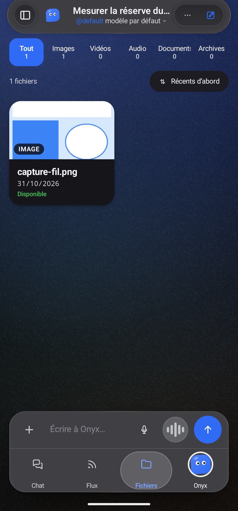 | 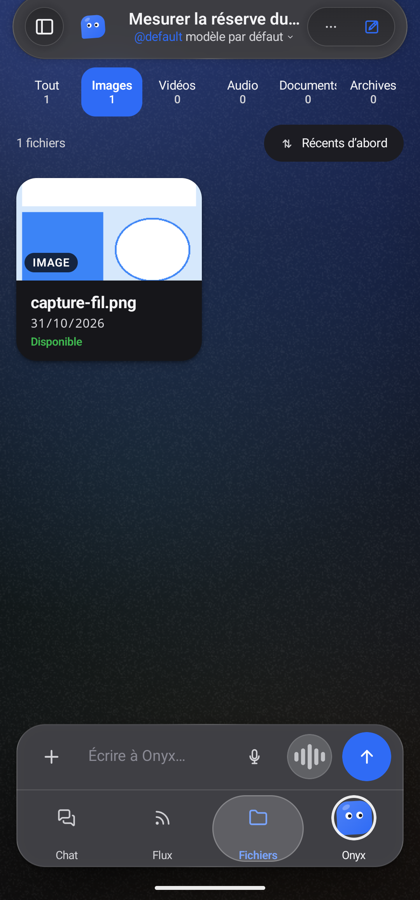 | 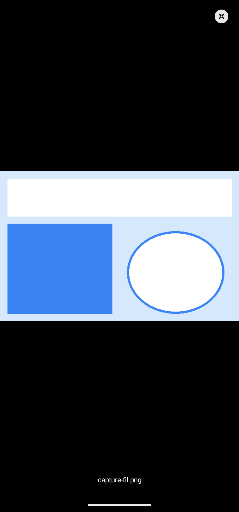 |

| Ideas | Goals | Code sessions | Kanban | Models |
|:---:|:---:|:---:|:---:|:---:|

| Voice — listening | Voice — ready | Computer | Terminal | Conversation actions |
|:---:|:---:|:---:|:---:|:---:|
|  | 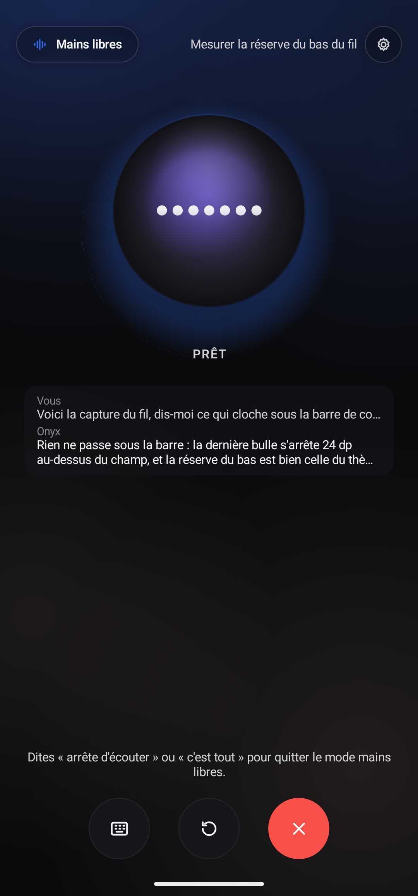 | 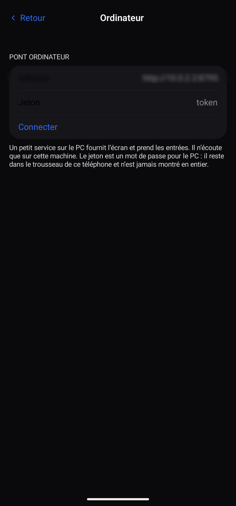 | 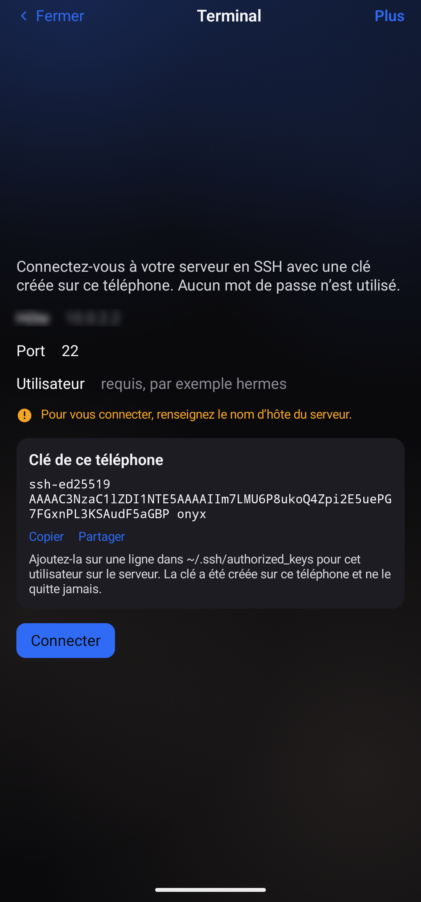 | 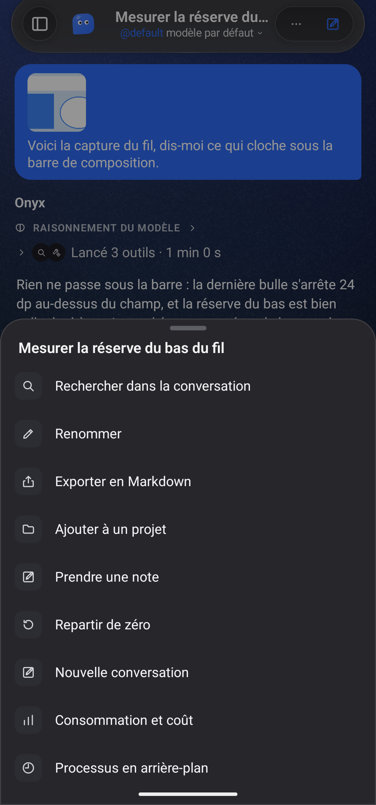 |

| Settings — gateway | Settings — voice & notifications | Settings — about |
|:---:|:---:|:---:|
| 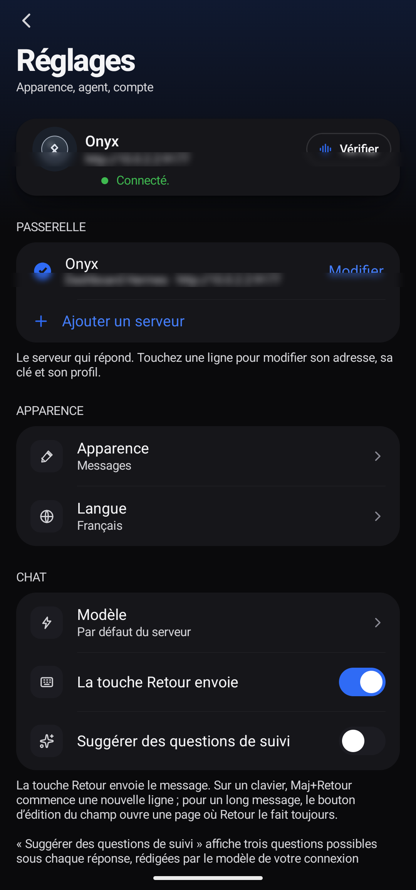 | 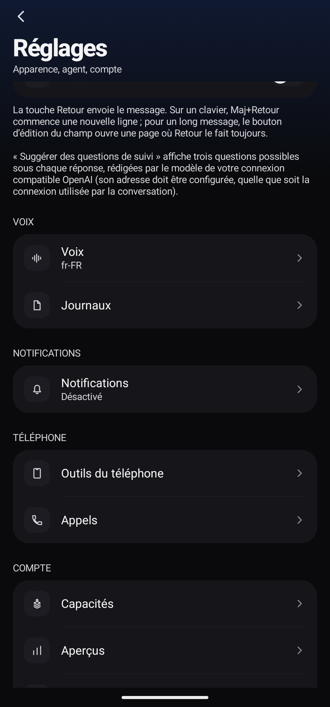 | 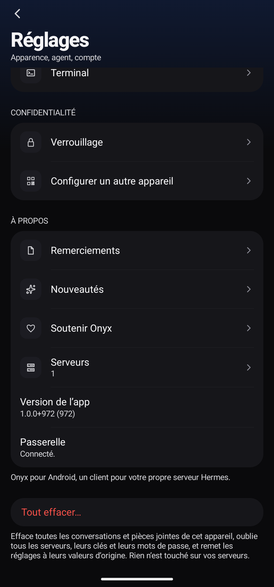 |

| Light — Chat | Light — Feed | Light — Settings |
|:---:|:---:|:---:|

| The panel, over the thread on a phone | The panel, docked beside the thread |
|:---:|:---:|
| 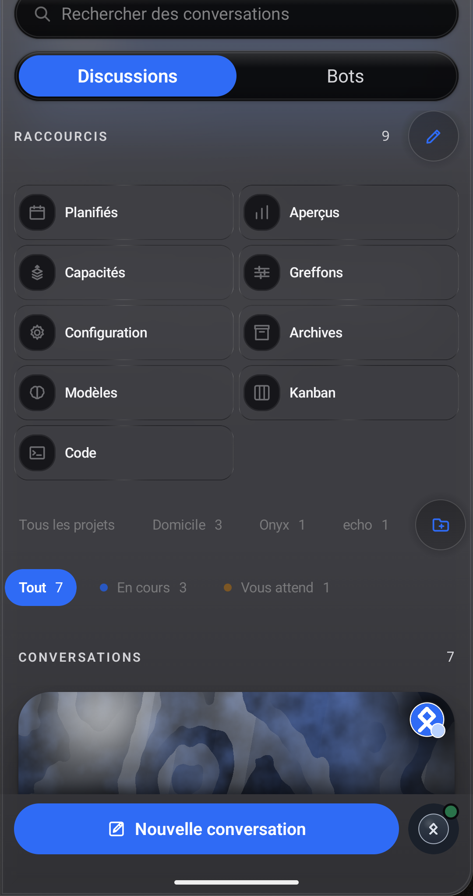 | 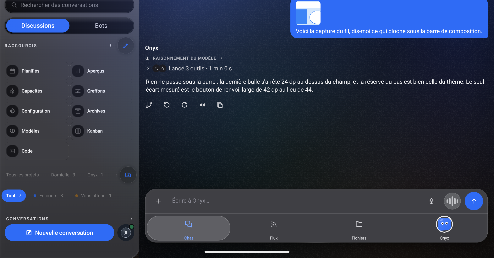 |

| The Archive screen | Capabilities — Skills and MCP |
|:---:|:---:|
| 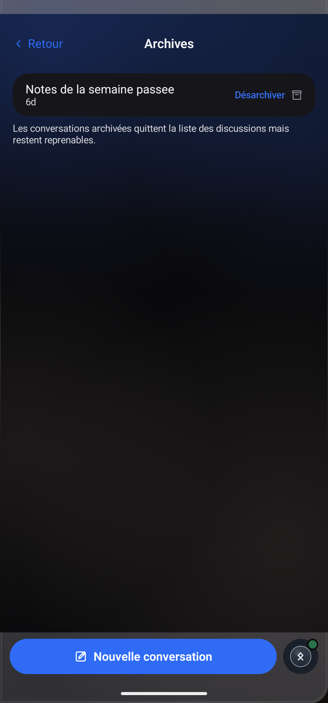 | 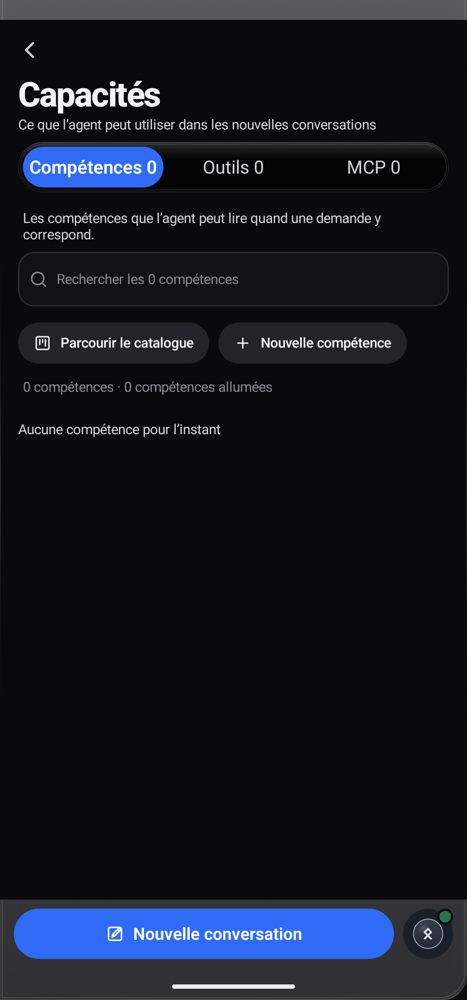 |

Every capture here is **`1.0.0+547`** — the build it was taken from — and each shot is labelled with
its build in [`docs/screenshots/README.md`](docs/screenshots/README.md). The bot
roster and the name on the cards are read from the server — the app lists the profiles it exposes, it
never invents one. The bot roster and the name on the cards are read from the server — the
app lists the profiles it exposes, it never invents one — and the name on the panel (`Onyx`, and
`homelab` in the docked shot) with the letter chip derived from it are the test double's, not a real
machine.

## Install

The signed APKs are on the [latest release](https://github.com/JemaOS/hermes-onyx/releases/latest)
page. One code base, one signing key.

| File | Runs on | What it is |
|---|---|---|
| `Hermes-Onyx-1.0.0+972-telephone.apk` | Phone, Android 8.0+ | The app: a sidebar, a chat and its five tabs, bots, rooms, voice, code, computer, servers, kanban, cron, files, terminal, widget. **The latest build.** |
| `Hermes-Onyx-1.0.0+972-auto.apk` | Android Auto | The car: an "Ask" screen that streams the answer into a message card and reads it aloud. |
| `Hermes-Onyx-1.0.0+972-wear.apk` | Wear OS 3+ (API 30) | The watch: a large microphone button, a live oscillogram, five states, and an "Ask Onyx" tile. |

**Coming from an older build?** `1.0.0+972` is signed with the same key as every release
before it, so it installs straight over `1.0.0+547`, `1.0.0+546` or `1.0.0` with no uninstall.

The three names above are the exact asset names on the releases. `1.0.0+972` carries a
`SHA256SUMS` file with the SHA-256 of every package it ships. Check your download against
it:

```bash
curl -LO https://github.com/JemaOS/hermes-onyx/releases/latest/download/SHA256SUMS
sha256sum -c SHA256SUMS
```

1. Download the APK for your device, open it, allow the install (the build is signed).
2. On first launch, scan the setup code from your server or type its address.
3. Pick a model, and talk.

The app talks to one host only: the one you typed. The API key sits in the Android Keystore, and
conversations stay in DataStore on the device.

## Requirements

- **Android 8.0 (API 26)** or newer — **Wear OS 3 (API 30)** for the watch.
- **A Hermes server you can reach**: a Dashboard (sessions, cron, kanban, files, gateway) and a
  conversation endpoint. The app asks for both; a single address can serve both if you proxy them together.

## Architecture

Four Gradle modules, one rule: nothing that is not a screen lives in a screen.

```
hermes-onyx/
├── app/     the phone app — screens, navigation, notifications, widget
├── core/    models, networking (OkHttp + JSON-RPC), design system, localization
├── wear/    a Wear OS companion — ask screen and tile
├── auto/    an Android Auto companion — ask screen
├── design/  source SVGs for the icons and the speaking orbs
├── scripts/ release archiving, orb rendering, gateway proxy
├── tools/   the computer bridge, icon tooling
└── docs/    the screenshots used by this README
```

- `core` holds no screen beyond Compose primitives, and it is unit-testable on a plain JVM.
- Every user-visible string goes through the localization catalogs in
  `core/src/main/java/com/onyx/app/localization/` — no hard-coded text in a screen.
- The wire protocol is the server's JSON-RPC over the Dashboard, plus an OpenAI-compatible
  `/v1/chat/completions` for the conversation stream.

## Build

You need **JDK 21** and the **Android SDK** (platform 36, build-tools 36).

```bash
./gradlew :app:assembleDebug        # a debug APK
./gradlew :app:assembleRelease      # a release APK
./gradlew :wear:assembleRelease :auto:assembleRelease
```

Release signing is deliberately out of the tree: point `ONYX_RELEASE_KEYSTORE` at a properties file
holding `storeFile`, `storePassword`, `keyAlias` and `keyPassword`. Without it the release build stays
unsigned instead of failing. `versionCode` is the commit count plus `onyx.versionBaseline`, so it only
ever goes up and an APK installs over the previous one.

## Tests

```bash
./gradlew :core:testDebugUnitTest :app:testDebugUnitTest
```

**2460 tests, 0 failures** — 1174 in `:core`, 1286 in `:app`. Plain JUnit 4, no
emulator: networking runs against an in-memory MockWebServer, so the recipe works offline and takes about
two minutes. CI runs the same command on every push.

The Wear OS and Android Auto modules have no unit tests of their own; they are verified at APK level —
build, signature, manifest, components.

## Roadmap

- [ ] Publish the Wear and Auto companions to Play, not only as APKs.
- [ ] A per-room voice mixer, so three bots do not all speak at the same level.
- [ ] Translations beyond English and French.
- [ ] Emulator-driven end-to-end tests on CI, not only the JVM suite.

## Contributing

Issues and pull requests are welcome. Four rules keep the tree healthy:

1. The test recipe stays green: `./gradlew :core:testDebugUnitTest :app:testDebugUnitTest`.
2. One change per pull request, with the reason in the description.
3. New user-visible text goes through the localization catalogs.
4. No secret, key, token or personal address lands in the tree.

## License

[MIT](LICENSE) © JemaOS. Use it, fork it, ship it — keep the copyright notice.

Bundled third-party components keep their own licenses; the full texts ship in
`core/src/main/assets/rich/LICENSES/` and are listed below.

## Acknowledgements

Onyx stands on the shoulders of others. Each license below was checked at its source — the Gradle module
metadata for the libraries, the shipped license file for the embedded assets:

- **[AndroidX](https://developer.android.com/jetpack/androidx)** and **[Jetpack Compose](https://developer.android.com/jetpack/compose)** — Apache-2.0, © The Android Open Source Project.
- **[Kotlin](https://kotlinlang.org/)**, **[kotlinx.coroutines](https://github.com/Kotlin/kotlinx.coroutines)**, **[kotlinx.serialization](https://github.com/Kotlin/kotlinx.serialization)** — Apache-2.0, © JetBrains s.r.o.
- **[OkHttp](https://square.github.io/okhttp/)** — Apache-2.0, © Square, Inc.
- **[Markwon](https://github.com/noties/Markwon)** — Apache-2.0, © Dimitry Ivanov.
- **[sshj](https://github.com/hierynomus/sshj)** — Apache-2.0, © Jeroen van Erp and contributors.
- **[EdDSA-Java](https://github.com/str4d/ed25519-java)** — CC0 1.0 Universal, © str4d.
- **[ZXing Android Embedded](https://github.com/journeyapps/zxing-android-embedded)** — Apache-2.0, © the ZXing authors and JourneyApps.
- **[KaTeX](https://katex.org/)** — MIT, © 2013-2020 Khan Academy and other contributors; its fonts under the SIL OFL 1.1.
- **[mermaid](https://mermaid.js.org/)** — MIT, © 2014-2022 Knut Sveidqvist.
- **[Inter](https://rsms.me/inter/)** — SIL OFL 1.1, © The Inter Project Authors.
- **[Source Code Pro](https://github.com/adobe-fonts/source-code-pro)** — SIL OFL 1.1, © Adobe (reserved font name "Source").

---

<div align="center">
<sub>No account. No telemetry. Your agent, your server, your phone.</sub>
</div>
