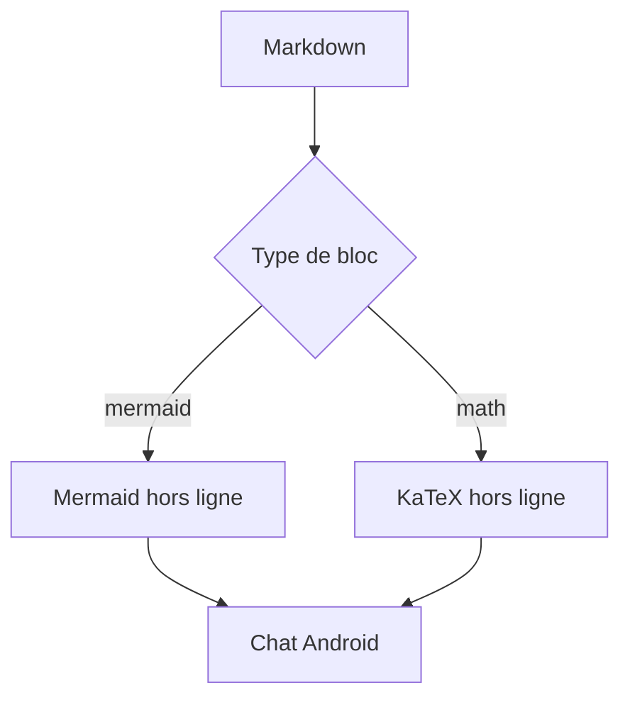

# Blocs riches — exemple de vérification

Ce fichier est un véritable document Markdown : chaque section couvre un rendu branché dans les
réponses du chat et du chat de groupe. Il sert aussi de scénario de vérification visuelle.

## Tableau avec alignements

| Fonction | État | Colonnes |
|:---------|:----:|---------:|
| Tableau  | **OK** | 3 |
| Cellule avec pipe \| échappé | `GFM` | 3 |

## Citation et blocs imbriqués

> **Citation riche.** Le contenu conserve le Markdown, avec une barre dans la couleur du thème.
>
> - [x] citation rendue
> - [ ] interaction encore à inspecter

## Cases à cocher

- [ ] case vide
- [x] case cochée
- [X] cochée avec un X majuscule

## Formules KaTeX

$$E = mc^2$$

\[
\int_0^1 x\,dx = \frac{1}{2}
\]

Un appui long sur une formule doit proposer **Copy LaTeX**.

## Diagramme Mermaid



Les commandes **Source / Diagram**, **Copy**, l'ouverture par tap et le plein écran avec zoom
doivent fonctionner sans réseau.

## Code avec coloration

```kotlin
// Les mots-clés, types, chaînes, nombres et commentaires suivent la palette active.
data class Answer(val text: String, val value: Int = 42)

fun render(answer: Answer): String = "${answer.text}: ${answer.value}"
```

Le bouton **Copy** doit copier uniquement le code. Pendant le streaming, le dernier bloc riche
reste temporairement dans cette fenêtre monochrome ; les blocs précédents gardent leur vrai rendu.
